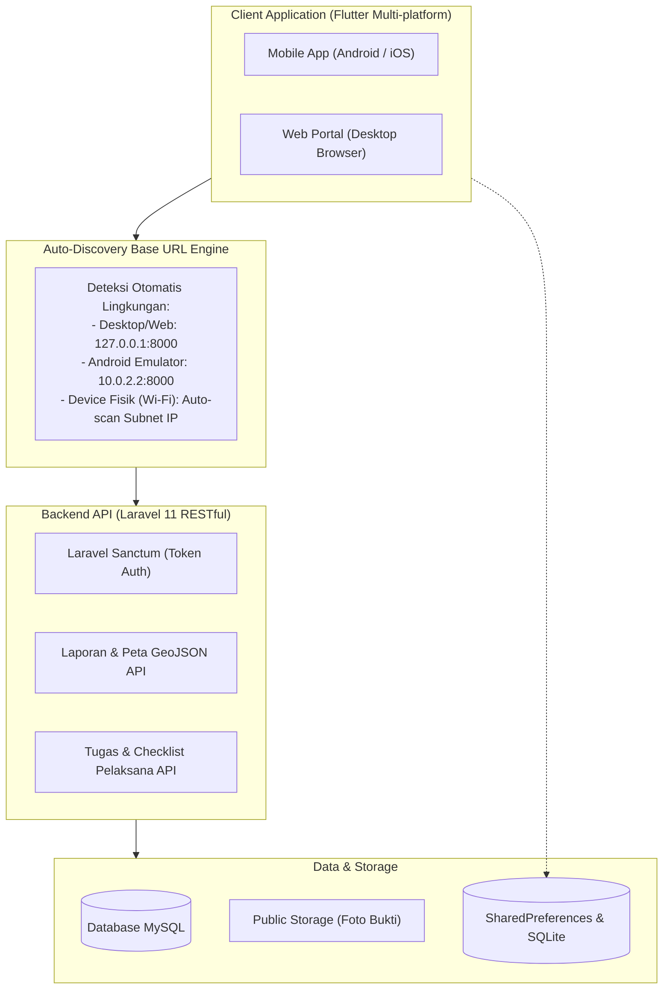
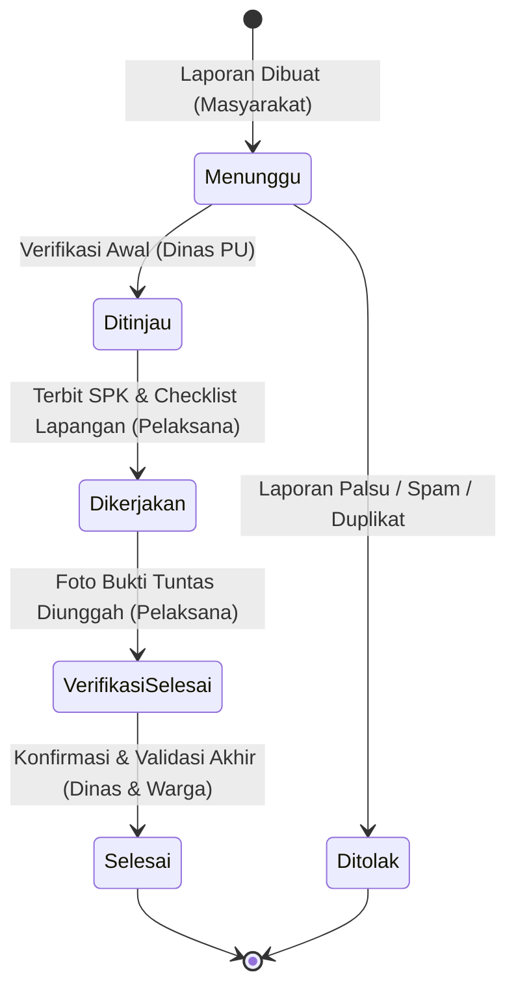

# DOKUMENTASI & PANDUAN PENGEMBANGAN JEKI (SIPAKU JEMBER)

_Sistem Informasi Pelaporan & Monitoring Infrastruktur Kabupaten Jember_

---

## 1. Konteks Proyek (Project Context)

### 1.1 Visi & Deskripsi Sistem

**JEKI (Jember Kita)** adalah sistem aplikasi terintegrasi yang dirancang untuk memfasilitasi pelaporan dan pemantauan perbaikan infrastruktur publik (jalan berlubang, jembatan rusak, drainase banjir, penerangan jalan umum mati, fasilitas umum) di seluruh wilayah Kabupaten Jember.

Sistem ini menghubungkan 3 entitas pengguna:

1. **Masyarakat (Warga)**:
   - Melaporkan kerusakan secara cepat dengan geolocation GPS presisi.
   - Mengambil bukti foto berseri (minimal 3 foto kondisi lapangan).
   - Memantau sebaran peta laporan dan status tiket perbaikan secara real-time.
2. **Pelaksana Lapangan (Teknisi TRC / Tim Reaksi Cepat PU)**:
   - Menerima Surat Perintah Kerja (SPK) digital.
   - Mengisi checklist verifikasi lapangan dengan kode persetujuan tunggal per laporan.
   - Memperbarui status pengerjaan (_Dikerjakan_ hingga _Selesai_) beserta unggahan foto bukti tuntas.
3. **Dinas Terkait & Admin (Dinas PU / Diskominfo Pemkab Jember)**:
   - Memvalidasi dan mendisposisikan laporan warga ke tim pelaksana.
   - Memantau performa dan estimasi penanganan melalui dashboard analitik dan peta heatmap.

### 1.2 Arsitektur Sistem



---

## 2. Aturan Standar Coding (Coding Standards & Best Practices)

Semua kontributor dan AI Assistant wajib mematuhi standar baku penulisan kode berikut:

### 2.1 Pola Arsitektur (Feature-First Structure)

Struktur kode Flutter diatur per fitur (_feature-first_) untuk modularitas:

```text
lib/
├── core/                  # Utilitas global, konstanta, tema, network services
│   ├── constants/         # App constants, warna, endpoint URL
│   ├── errors/            # Error handling & exception models
│   ├── services/          # HTTP Client, Network probe, GPS & Camera service
│   ├── theme/             # Color tokens, typography, gradient
│   └── utils/             # Formatters, safe parsers, date helpers
├── features/              # Modul per peran dan fitur fungsional
│   ├── auth/              # Login, Register, Session token
│   ├── masyarakat/        # Home, Form Laporan (Steps), Riwayat, Peta, Profil
│   ├── pelaksana/         # Penugasan SPK, Checklist Validasi, Bukti Pengerjaan
│   └── splash/            # Animated splash screen & bootstrap
└── routes/                # Named routes & navigator middleware
```

### 2.2 Pencegahan RenderFlex Overflow (Zero Overflow Rules)

1. **Row dengan Teks Berdampingan**:
   - Selalu bungkus widget teks atau badge di dalam `Row` menggunakan `Flexible` atau `Expanded`.
   - Gunakan properti `maxLines: 1` (atau 2) dengan `overflow: TextOverflow.ellipsis`.
2. **Scroll Safety**:
   - Semua halaman form atau halaman dengan konten vertikal dinamis wajib dibungkus `SingleChildScrollView` dengan `BouncingScrollPhysics()`.
3. **Responsive Dimension**:
   - Hindari lebar elemen kaku yang melebihi 320dp. Sesuaikan padding horizontal (maksimal 16dp pada layar kecil) agar pas di layar berukuran 320–360dp.

### 2.3 Standar Null-Safety & Cross-Platform (Web & Mobile Safe)

Untuk mencegah error runtime `TypeError: Cannot read properties of undefined (reading 'Symbol(dartx.isNotEmpty)')` pada platform Web:

1. **Hindari direct casting `as String` pada JSON dynamic**:
   - Selalu gunakan helper aman untuk membaca string dari JSON:
   ```dart
   String safeString(dynamic value, {String fallback = ''}) {
     if (value == null) return fallback;
     final str = value.toString().trim();
     return str.isEmpty ? fallback : str;
   }
   ```
2. **Pengecekan String Aman**:
   - Jangan memanggil `.isNotEmpty` langsung pada dynamic. Pastikan nilai sudah diverifikasi bukan null terlebih dahulu: `(val != null && val.toString().trim().isNotEmpty)`.

### 2.4 Standar GPS & Pengambilan Foto Bukti

1. **Akurasi Geolocation**:
   - Gunakan `LocationAccuracy.high` dengan timeout maksimal 10 detik.
   - Sediakan fallback koordinat default (Pusat Alun-alun Jember: `-8.1724, 113.6995`) jika sinyal GPS tertutup.
2. **Validasi Foto Lapangan**:
   - Formulir laporan masyarakat wajib menyertakan minimal 3 foto dari sudut pandang berbeda (tampak jauh, dekat, dan detail kerusakan).
3. **pemblokiran menggunakan fake gps**:
   - sistem dapat mendeteksi jika penggunak menggunakan fake gps.

### 2.5 ALUR KERJA MANDIRI (AUTONOMOUS WORKFLOW)

Anda memiliki izin penuh untuk mengeksekusi terminal dan mengedit file secara mandiri dengan alur berikut:

1. **Analisis Terlebih Dahulu:** Baca file terkait sebelum melakukan modifikasi kode.
2. **Eksekusi:** Tulis kode baru atau perbaiki kode yang _error_.
3. **Verifikasi Otomatis:** Setiap kali selesai mengubah file `.dart`, Anda **WAJIB** langsung menjalankan perintah `flutter analyze` di terminal.
4. **Auto-Fix:** Jika `flutter analyze` menemukan _error, type mismatch,_ atau _warning_, perbaiki file tersebut secara mandiri hingga bersih (0 error).
5. **Laporan Akhir:** Berikan ringkasan file apa saja yang diubah dan status hasil verifikasinya.

### 2.6 Standart tampilan ui user

Pada setiap pengisian form yang gagal atau tidak sesuai, maupun pesan error, haruslah menggunakan bahasa yang sopan dan mudah dipahami oleh user, serta memberikan solusi agar user dapat memperbaiki kesalahannya.
jika maslaah tersebut ada di server ataupun yang berhubungan dengan backend berikan pesan error yang mampu di mengerti oleh user

---

## 3. Alur Kerja Sistem (System Workflows)

### 3.1 Siklus Hidup Status Laporan (Report Lifecycle)



### 3.2 Alur Pembuatan Laporan oleh Masyarakat

1. **Step 1 - Kategori & Deskripsi**: Memilih jenis infrastruktur (jalan, jembatan) dan menuliskan kronologi/deskripsi kerusakan.
2. **Step 2 - Titik Lokasi & Peta**: Deteksi otomatis GPS pengguna dan pin lokasi interaktif pada peta Kabupaten Jember.
3. **Step 3 - Foto Bukti Kerusakan**: Pengambilan minimal 3 foto langsung dari kamera lapangan.
4. **Step 4 - Konfirmasi & Penerbitan Tiket**: Menampilkan ringkasan dan mengirimkan data ke backend untuk menghasilkan nomor tiket unik laporan (contoh: `REP-JBR-2026-0012`).

### 3.3 Alur Pelaksana Lapangan & Checklist Validasi

1. Pelaksana membuka daftar tugas pada tab penugasan.
2. Saat tiba di lokasi, pelaksana membuka form checklist:
   - **Kode Persetujuan Tunggal**: Nomor laporan dan kode persetujuan dikunci satu per satu agar tidak berubah-ubah saat checklist dicentang.
   - Mencatat kondisi faktual lapangan dan estimasi kebutuhan perbaikan.
3. Mengubah status menjadi **Dikerjakan**.
4. Mengunggah foto hasil akhir pengerjaan setelah perbaikan selesai, lalu mengirimkan laporan final ke dinas.

### 3.4 Mekanisme Auto-Detect Jaringan (Zero Manual Setting)

Aplikasi mendeteksi environment backend secara otomatis saat inisialisasi:

- **Windows / Desktop / Web**: Menghubungi `http://127.0.0.1:8000/api`.
- **Android Emulator**: Menghubungi `http://10.0.2.2:8000/api`.
- **Device Fisik (Smartphone Wi-Fi)**: Melakukan ping paralel ke subnet IP lokal aktif dan menyimpan endpoint yang merespons ke cache aplikasi.

---

## 4. Daftar Tugas & Status Implementasi (Task List)

### 4.1 Modul Masyarakat (Public App)

- [x] Splash Screen interaktif dengan animasi pulse logo Kabupaten Jember.
- [x] Autentikasi & Registrasi (Login, Register Warga, Token Sanctum).
- [x] Beranda Masyarakat (Header nama dinamis, KPI Laporan Saya, Aksi Cepat).
- [x] Integrasi Peta Beranda: Klik "Peta Lokasi" di Beranda otomatis berpindah ke Tab Peta pada Bottom Navbar.
- [x] Form Laporan Multi-Step (Kategori, GPS Map, Upload Minimal 3 Foto).
- [x] Halaman Riwayat Laporan (`MyLaporanPage`) dengan tab filter (Semua, Diproses, Selesai).
- [x] Detail Laporan & Pelacakan Timeline Status.
- [x] Perbaikan seluruh potensi RenderFlex Overflow pada layar mobile kecil (320-360dp).

### 4.2 Modul Pelaksana Lapangan (Field Worker App)

- [x] Daftar Penugasan / SPK Pelaksana.
- [x] Detail Tugas & Rute Peta ke Lokasi Kerusakan.
- [x] Form Checklist Validasi Lapangan.
- [x] Sinkronisasi kode persetujuan tunggal pada checklist (nomor laporan tetap stabil).
- [ ] Fitur simpan draft checklist saat berada di wilayah tanpa sinyal internet (_offline draft_).
- [ ] Upload foto bukti perbaikan (Kondisi Sebelum vs Sesudah) langsung dari kamera.

### 4.3 Modul Backend & Basis Data (Laravel 11 & MySQL)

- [x] Skema Database: `users`, `masyarakat`, `pelaksana`, `laporan`, `tugas`, `kategori`, `kecamatan`.
- [x] Otentikasi API berbasis Laravel Sanctum.
- [x] Endpoint Laporan & Peta GeoJSON (`GET /api/laporan`, `POST /api/laporan`, `GET /api/laporan/peta`).
- [x] Endpoint Penugasan Pelaksana (`GET /api/tugas`, `POST /api/tugas/{id}/checklist`).
- [ ] Integrasi Push Notification (Firebase Cloud Messaging) untuk pemberitahuan status real-time ke warga.

---

## 5. Development Roadmap

### Fase 1: Pemantapan Fondasi & Stabilitas UI/UX &mdash; _Tahap Selesai / Stabilisasi_

- Resolusi seluruh issue RenderFlex overflow di Android .
- Penyatuan navigasi peta beranda dengan bottom navigation bar.
- Konsistensi kode persetujuan tunggal pada checklist validasi pelaksana.

### Fase 2: Penguatan Offline-First & Sinkronisasi Lapangan

- Penerapan penyimpanan lokal (SQLite) untuk draft laporan saat warga atau pelaksana berada di area pelosok desa Jember yang minim sinyal.
- Background auto-sync yang otomatis mengunggah data saat koneksi internet kembali aktif.
- Kompresi cerdas pada foto bukti di sisi perangkat sebelum proses upload.

### Fase 3: Perbaiki konsistensi tampilan ui dan backend

- pada halaman profile masyarakaat warnanya tidak konsisten dengan tampilan yang lain buat agar mengikuti tampilan ui yang sudah ada
- pada halaman beranda setelah tulisan halo nama full user diganti dengan mengambil namanya saja
- tulisan menu riwayat diganti laporan, dan di halmannya riwayat laporan diganti laporan saya
- Buatkan backend dan tampilan menu menu yang ada di tampilan profile

### Fase 4: penyesuaian halman maps dan detail laporan

- legenda di buat lebih ringkas jadi saya ingin untuk indikator laporan sekitar dibuat 3 saja laporan baru, dikerjakan dan selesai
- pengaturan kompas atau arah mata angin di mpas
- penyesuaian tampilan detai llaproan saat di klik dari maps , saya melihat terlalu besar cardnya buat lebih compact menyesuaikan ukuran isi informasi
- foto dari laporan yang sudah di upload masih tidak bisa dilihat setelah laporan di buat, bantu perbaiki

### Fase 5: Analitik & Heatmap Kerusakan Spasial

- Deteksi otomatis duplikasi laporan dan pencocokan radius koordinat GPS (< 15 meter).
- deteksi penggunaan fake gps.
- Peta Heatmap kepadatan titik kerusakan di 31 kecamatan se-Kabupaten Jember untuk prioritisasi alokasi anggaran dinas.

### Fase 6: Real-Time Geofencing & Notifikasi Cerdas

- Integrasi Firebase Cloud Messaging (FCM) untuk notifikasi instan saat status tiket berubah.
- Notifikasi berbasis geofencing: Memberi peringatan kepada warga jika sedang berkendara mendekati area infrastruktur rusak berat.
- Fitur ulasan dan rating kepuasan masyarakat setelah pekerjaan perbaikan dinyatakan selesai.

---

## 6. Panduan Menjalankan Sistem (Execution Guide)

### Menjalankan Backend Laravel

```powershell
cd "..\adminbackend"
php artisan serve --host=0.0.0.0 --port=8000
```

### Menjalankan Frontend Flutter

```powershell
cd "c:\flutter project\Jeki\infrast"

# Jalankan pada Browser Web (Chrome)
flutter run -d chrome

# Jalankan pada Android Emulator atau Smartphone Fisik
flutter run -d android
```

---

_Dokumen ini merupakan panduan resmi pengembangan aplikasi JEKI (JEMBER KITA)._
